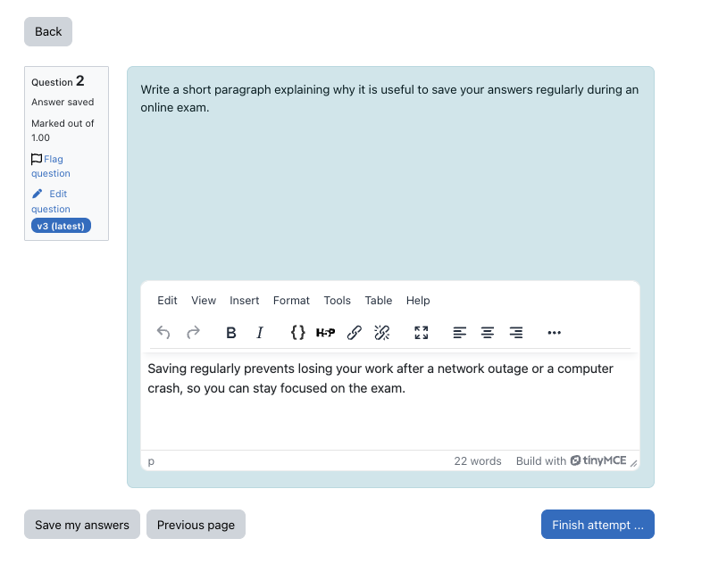
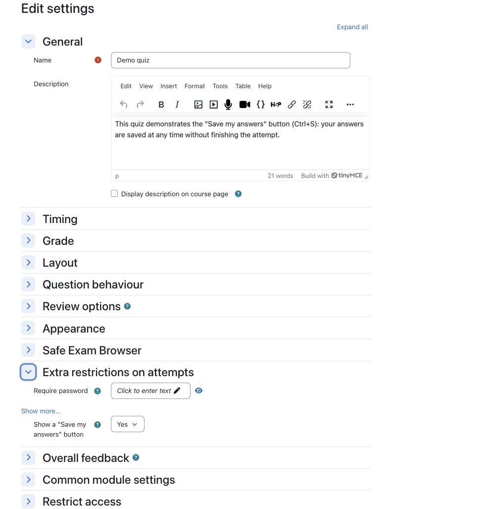

# Save answers at any time (quizaccess_savenow)

A quiz access rule that adds a **Save my answers** button and the **Ctrl+S** shortcut
(**Cmd+S** on Mac) to every quiz attempt page.

Students can save their answers at any time, without leaving the page they are on and
without finishing or submitting the attempt. This is useful for long pages of questions
(essays in particular), where students worry about losing their work before they click
"Next page".

## How it works

The button uses the normal quiz navigation: it submits the attempt form and asks Moodle
to come back to the same page. Moodle saves the answers exactly as when "Next page" is
clicked, the page reloads at the same place, and a message confirms that the answers
have been saved. The attempt is neither finished nor submitted, and no data is stored
outside of the quiz attempt.

## Requirements

- Moodle 4.5 to 5.3.

## Installation

1. Copy the plugin folder as `mod/quiz/accessrule/savenow` (from Moodle 5.1 on:
   `public/mod/quiz/accessrule/savenow`), or install the ZIP file through
   *Site administration > Plugins > Install plugins*.
2. Go to *Site administration > Notifications* to complete the installation.

## Usage

In the quiz settings, under *Extra restrictions on attempts*, set
**Show a "Save my answers" button** to *Yes* (the default for new quizzes).
Quizzes that existed before the plugin was installed do not show the button until this
setting is turned on.

The setting is kept when a quiz is backed up, restored or duplicated.

## Privacy

The plugin stores no personal data: only one setting per quiz.

## Development

- JavaScript: edit `amd/src/save.js`, then rebuild `amd/build/` from the root of a
  Moodle checkout with `npx grunt amd --root=public/mod/quiz/accessrule/savenow`.
- Checks: [moodle-plugin-ci](https://moodlehq.github.io/moodle-plugin-ci/) runs on every
  push and pull request (see `.github/workflows/moodle-plugin-ci.yml`).
- PHPUnit: `vendor/bin/phpunit --testsuite quizaccess_savenow_testsuite`.
- Behat: `vendor/bin/behat --tags=@quizaccess_savenow`.

## License

2026 UniDistance Suisse

This program is free software: you can redistribute it and/or modify it under the terms
of the GNU General Public License as published by the Free Software Foundation, either
version 3 of the License, or (at your option) any later version.

This program is distributed in the hope that it will be useful, but WITHOUT ANY
WARRANTY; without even the implied warranty of MERCHANTABILITY or FITNESS FOR A
PARTICULAR PURPOSE. See the GNU General Public License for more details.

You should have received a copy of the GNU General Public License along with this
program. If not, see <https://www.gnu.org/licenses/>.
